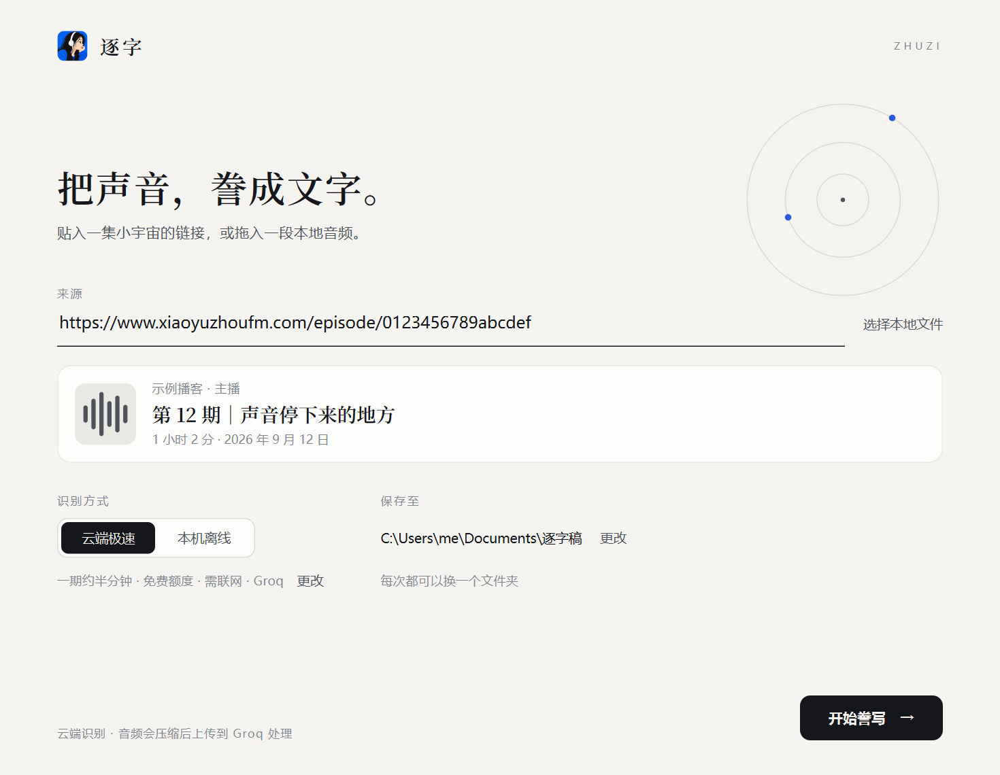
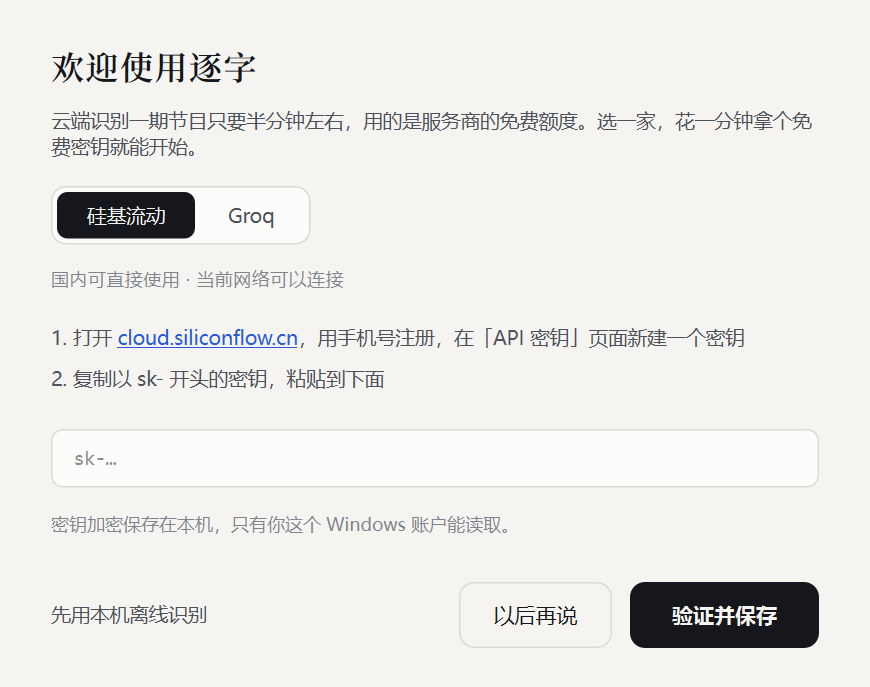

<p align="center"></p>

<h1 align="center">逐字</h1>

<p align="center">把播客誊成文字。贴一个小宇宙链接，或拖入一段音频，半分钟拿到带时间戳的逐字稿。</p>

<p align="center">
  <a href="https://github.com/EllenZhang708/zhuzi/releases/latest/download/Zhuzi-x64-setup.exe"></a>
  &nbsp;
  <a href="https://github.com/EllenZhang708/zhuzi/releases/latest/download/Zhuzi-arm64-setup.exe"></a>
</p>
<p align="center">
  <a href="https://github.com/EllenZhang708/zhuzi/releases/latest/download/Zhuzi-mac-apple-silicon.dmg"></a>
  &nbsp;
  <a href="https://github.com/EllenZhang708/zhuzi/releases/latest/download/Zhuzi-mac-intel.dmg"></a>
</p>
<p align="center"><sub>点按钮直接下载最新版 · 大多数 Windows 电脑选 Windows 版，2020 年以后的 Mac 大多是 Apple 芯片 · <a href="https://github.com/EllenZhang708/zhuzi/releases/latest">全部下载与更新说明</a></sub></p>

<p align="center"></p>

## 能做什么

- **贴链接就能转**：支持小宇宙单集链接，也支持本地的 MP3、M4A、WAV 等音频。
- **很快**：云端识别一期 80 分钟的节目，大约半分钟。
- **免费**：用的是硅基流动和 Groq 的免费额度；你用自己的密钥，额度归你自己。
- **也能离线**：本机离线识别（SenseVoice）不联网、不上传音频，首次使用下载约 230 MB 的模型。
- **好读的稿子**：自动加标点、分段、每段带时间戳，输出 Markdown，可以直接放进 Obsidian 等笔记软件。
- **识别更准**：自动把节目名、主播名告诉识别模型，并用拼音纠正同音错字；会过滤语音模型在片头音乐上“编”出来的句子。

## 下载

点下面的链接直接下载最新版：

| 你的电脑 | 安装版（推荐） | 免安装版 |
|---|---|---|
| 大多数 Windows 电脑（Intel / AMD） | [Zhuzi-x64-setup.exe](https://github.com/EllenZhang708/zhuzi/releases/latest/download/Zhuzi-x64-setup.exe) | [Zhuzi-x64-portable.zip](https://github.com/EllenZhang708/zhuzi/releases/latest/download/Zhuzi-x64-portable.zip) |
| 骁龙等 ARM 芯片的 Windows 电脑 | [Zhuzi-arm64-setup.exe](https://github.com/EllenZhang708/zhuzi/releases/latest/download/Zhuzi-arm64-setup.exe) | [Zhuzi-arm64-portable.zip](https://github.com/EllenZhang708/zhuzi/releases/latest/download/Zhuzi-arm64-portable.zip) |
| Apple 芯片（M1、M2、M3、M4 等）的 Mac | [Zhuzi-mac-apple-silicon.dmg](https://github.com/EllenZhang708/zhuzi/releases/latest/download/Zhuzi-mac-apple-silicon.dmg) | — |
| Intel 处理器的 Mac | [Zhuzi-mac-intel.dmg](https://github.com/EllenZhang708/zhuzi/releases/latest/download/Zhuzi-mac-intel.dmg) | — |

历史版本和更新说明在 [Releases](https://github.com/EllenZhang708/zhuzi/releases) 页面。

不确定是哪种？
- **Windows**：打开「设置 → 系统 → 系统信息」，看「系统类型」：写着“基于 ARM”就选 arm64，否则选 x64。
- **Mac**：点屏幕左上角的苹果菜单 → 「关于本机」：写着“芯片 Apple M…”选 Apple 芯片版，写着“处理器 Intel…”选 Intel 版。Mac 版需要 macOS 12（Monterey）或更新的系统；如果「应用程序」里逐字的图标上有🚫，说明系统版本太旧。

> **Windows**：第一次运行时，可能提示“Windows 已保护你的电脑”或“未知发布者”——这是因为本项目没有购买代码签名证书。点「更多信息 → 仍要运行」即可。所有代码都公开在本仓库，可以自行检查或构建。

### Mac：第一次打开要“放行”一次

本项目没有加入 Apple 的付费开发者计划（每年 99 美元），所以 macOS 不认识逐字，第一次打开会拦下来。放行一次之后，就和普通 app 一样双击打开。

先打开下载好的 `.dmg`，把「逐字」拖进「应用程序」，然后按系统版本放行（苹果菜单 →「关于本机」可以看到版本）：

**macOS 12、13、14（Monterey、Ventura、Sonoma）**

1. 在「应用程序」里按住 Control 键点逐字（触控板上也可以两指轻点），选「打开」。
2. 弹出“无法验证开发者”的提示时，点「打开」。

> 如果第 2 步只有「移到废纸篓」和「取消」：先点「取消」，打开「系统偏好设置 → 安全性与隐私 → 通用」（macOS 13、14 是「系统设置 → 隐私与安全性」），在“已阻止使用‘逐字’”旁边点「仍要打开」。

**macOS 15 及以后（Sequoia、Tahoe）**

1. 在「应用程序」里双击逐字。系统提示“Apple 无法验证‘逐字’……”，点「完成」。
2. 打开「系统设置 → 隐私与安全性」，拉到最下面，在“已阻止‘逐字’以保护 Mac”旁边点「仍要打开」，输入开机密码。
3. 再双击逐字，点「仍要打开」。

> 系统是英文的话：「打开」是 Open，「仍要打开」是 Open Anyway，「系统偏好设置 → 安全性与隐私 → 通用」是 System Preferences → Security & Privacy → General。
>
> 熟悉“终端”的话，任何版本都可以用一条命令代替上面的步骤：`xattr -dr com.apple.quarantine /Applications/逐字.app`
>
> 每次下载新版本替换旧版后，需要再放行一次。第一次保存文稿时，macOS 会问是否允许逐字访问「文稿」文件夹（逐字稿默认存在 文稿/逐字稿），点「允许」即可。

### 卸载

- **Windows**：「设置 → 应用 → 已安装的应用」里找到逐字，点「卸载」。
- **Mac**：把「应用程序」里的逐字拖到废纸篓。设置和离线模型在 `~/Library/Application Support/Zhuzi`，密钥在「钥匙串访问」里名为 Zhuzi 的项目，想彻底清除可以一并删掉。转写好的文稿不会被删除。

## 第一次使用：拿一个免费密钥（约一分钟）

打开逐字时会出现欢迎向导，选一家云端服务：

| 服务 | 适合 | 免费额度 | 拿密钥 |
|---|---|---|---|
| **硅基流动**（SenseVoice） | 中国大陆用户 | 语音识别模型免费 | [cloud.siliconflow.cn](https://cloud.siliconflow.cn/account/ak) 用手机号注册，**先完成实名认证**，再在「API 密钥」页新建 |
| **Groq**（Whisper large-v3-turbo） | 海外用户 | 每天约 8 小时音频 | [console.groq.com](https://console.groq.com/keys) 注册，点 Create API Key |

两家都填的话，一家连不上时会自动换另一家。也可以点「先用本机离线识别」跳过这一步。

<p align="center"></p>

## 隐私

- **云端识别**：音频会被压缩后上传到你选择的服务商（硅基流动或 Groq）处理，适用它们各自的条款。上传前会在本机去掉音乐和静音片段。
- **本机离线识别**：音频不会离开你的电脑。
- **密钥**：Windows 上用系统的 DPAPI 加密保存在本机，只有你这个 Windows 账户能解开；Mac 上存在系统的「钥匙串」里。
- 逐字没有自己的服务器，不收集任何数据。

## 版权提醒

小宇宙链接功能仅为方便个人学习和笔记整理。播客内容的版权属于原作者，请勿将转写稿用于转载、商用或其他侵权用途。本项目与小宇宙、各播客节目均无关联。

## 输出示例

```markdown
---
title: "第 12 期｜声音停下来的地方｜逐字稿"
podcast: "示例播客"
source: "https://www.xiaoyuzhoufm.com/episode/…"
duration: "01:02:05"
model: "Groq whisper-large-v3-turbo"
---

## 完整逐字稿

`00:01:01` 欢迎来到新一期的节目。今天想和你聊聊，声音和文字之间到底隔着什么……
```

## 从源码构建

需要 Python 3.12。

Windows 10/11：

```powershell
python -m venv .venv-x64                # ARM 电脑用 ARM64 版 Python 建 .venv-arm64
.venv-x64\Scripts\python -m pip install -r requirements.txt
.venv-x64\Scripts\python src\app.py     # 直接运行
.venv-x64\Scripts\python tests\test_text.py; .venv-x64\Scripts\python tests\test_cloud.py
.\build.ps1 -Arch x64                    # 打包到 dist\
```

macOS（用 python.org 的 Python 3.12 安装包；打出来的 app 支持 macOS 12+）：

```bash
python3.12 -m venv .venv-mac
# 只装为 macOS 12 打包的依赖，否则在新系统上 pip 会选只支持新系统的版本
.venv-mac/bin/python -m pip download --only-binary=:all: --platform "macosx_12_0_$(uname -m)" -d build/wheels -r requirements.txt
.venv-mac/bin/python -m pip install --no-index --find-links build/wheels -r requirements.txt
.venv-mac/bin/python src/app.py          # 直接运行
./build_mac.sh                           # 打包当前芯片的 逐字.app 和 dist/ 里的 .dmg
bash tests/check_mac_app.sh              # 检查打包好的 app：签名、离线转写、各个界面
```

Windows 安装程序由 `installer\zhuzi.iss`（Inno Setup 6.5+）生成。推送 `v*` 标签后，GitHub Actions 会自动构建 Windows（x64、ARM64）和 Mac（Apple 芯片、Intel）四个版本，在 Mac 上实际跑一遍检查，然后起草 Release。

代码结构：

| 文件 | 作用 |
|---|---|
| `src/app.py` | 界面（PySide6） |
| `src/core.py` | 任务流程、小宇宙解析、下载、文字整理、Markdown |
| `src/cloud.py` | 云端识别：硅基流动、Groq，自动切换 |
| `src/local.py` | 本机离线识别：SenseVoice（sherpa-onnx） |
| `src/audio.py`、`src/vad.py` | 解码、切段、压缩；Silero 人声检测 |
| `src/secrets_store.py` | 密钥保存（Windows DPAPI、macOS 钥匙串） |
| `src/mac.py` | Mac 专用：誊写时不让系统睡眠、遵循“减弱动态效果” |

## 许可证

本项目代码以 [MIT](LICENSE) 许可发布。发行版中包含的第三方组件及其许可见 [THIRD_PARTY_NOTICES.md](THIRD_PARTY_NOTICES.md)。

---

## English

**Zhuzi (逐字)** turns a podcast episode — a Xiaoyuzhou link or a local audio file — into a timestamped Markdown transcript, in about half a minute for an 80-minute episode. It uses the free tiers of SiliconFlow (SenseVoice, reachable in mainland China) or Groq (Whisper large-v3-turbo), with your own key, or runs fully offline with SenseVoice. Native builds for Windows x64 and ARM64 and for macOS 12+ (Apple silicon and Intel). Keys are encrypted with DPAPI on Windows and kept in the Keychain on macOS; there is no server and no telemetry. The Mac app is not notarized, so the first launch must be allowed in System Settings → Privacy & Security → Open Anyway (or run `xattr -dr com.apple.quarantine /Applications/逐字.app`). MIT licensed; see THIRD_PARTY_NOTICES.md for bundled components.
